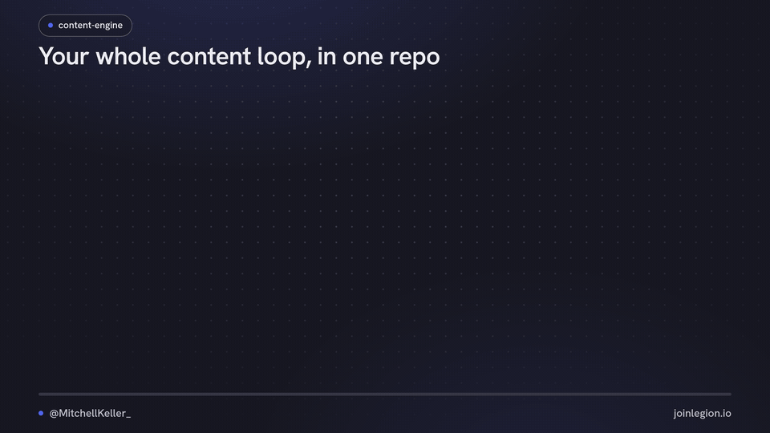

# content-engine

**Your content loop in one repo: find ideas in work you actually did, write them in your own voice, reuse what worked, and give your best X posts a second push.**



Four parts. Each one works without the others:

| Part | What you get | Setup |
|---|---|---|
| [`voice/`](voice/) | A `VOICE.md` built from your own posts, so AI drafts sound like you | 15 min, no API key needed |
| [`gather/`](gather/) | A daily ideas brief from your bookmarks, GitHub activity and call notes, scored against your past winners | 10 min |
| [`repurpose/`](repurpose/) | X to LinkedIn rewrites, quote posts, an HTML-to-PNG/MP4/GIF graphics kit, and Typefully drafts | 10 min |
| [`automations/`](automations/) | Trigger.dev jobs that watch your X posts, ping you (or reply with a plug) when one clears your bar, and can optionally repost winners | 30 min, X API + Postgres |

Plus [`skills/`](skills/): drop-in instructions for Claude Code, Codex or Cursor that tie the parts together, including a no-ai-slop pass.

## Quickstart

```bash
git clone https://github.com/MitchellkellerLG/content-engine.git && cd content-engine
cp .env.example .env            # fill in only what you use, never commit it

# 1. Your voice (start here, everything else reads it)
python3 voice/pull_posts.py x-archive ~/Downloads/twitter-archive/data/tweets.js
python3 voice/analyze.py        # then follow voice/README.md

# 2. Tomorrow's ideas
python3 gather/build_context.py # then follow gather/README.md

# 3. A graphic from the kit (needs: pip install playwright && python3 -m playwright install chromium)
python3 repurpose/graphics/render.py repurpose/graphics/examples/three-steps --stills
```

New here? [SETUP.md](SETUP.md) walks through the first run and the questions to answer before you switch anything on.

## Nothing posts without you

- No part of this repo publishes anything by default.
- The X automations are **off** until you set a switch. Plug replies start in **notify-only** mode: you get a message and post the reply yourself.
- Auto-repost is off, and repeat "bumps" need a second switch on top of that. Read [docs/x-rules.md](docs/x-rules.md) before you turn either on.
- Typefully is used for **drafts**. You schedule them.
- Nothing here logs into, scrapes or automates LinkedIn.

## Disclaimer

This is a free, unofficial tool shared as is, with no warranty. You're responsible for how you use it. Before you turn anything on, read and follow the current terms, developer policies and automation rules of every platform and API it touches, including [X's Developer Agreement and Policy](https://developer.x.com/en/developer-terms), [X's automation rules](https://help.x.com/en/rules-and-policies/x-automation), Typefully, Trigger.dev, GitHub and any AI provider you use. Those rules and API prices change often, so check them yourself rather than relying on the notes in this repo. Nothing here is legal advice, and it isn't affiliated with or endorsed by any of those platforms. If an action could get your account limited or suspended, don't automate it.

## Requirements

Python 3.10+ (standard library only for `voice/` and `gather/`). Node 22.6+ for `automations/`. Playwright and ffmpeg only if you render graphics. `gh` only for GitHub activity.

## Checks

```bash
scripts/check.sh   # unit tests, typecheck, secret scan
```

## License

MIT, see [LICENSE](LICENSE). Third-party credits (no-ai-slop, Typefully CLI, fonts) are in [THIRD_PARTY_NOTICES.md](THIRD_PARTY_NOTICES.md). Security notes are in [SECURITY.md](SECURITY.md).

---

Made by [@MitchellKeller_](https://x.com/MitchellKeller_) · [joinlegion.io](https://joinlegion.io)
