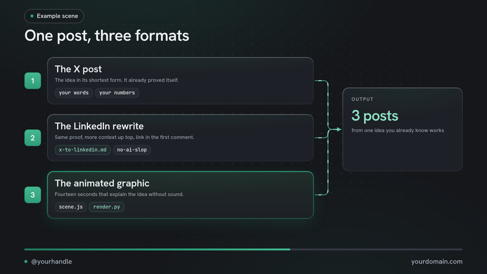

# Animated diagram kit

14-second looping diagrams for posts: cards build on, wires draw and flow, each step highlights in turn, then it fades and loops. One HTML page per scene, rendered frame by frame in a headless browser, so every frame is exact.



## Make one

```bash
pip install playwright && playwright install chromium     # or set CHROME_PATH to your Chrome
cp -r repurpose/graphics/examples/three-steps my-post      # any folder works
# edit my-post/scene.js: words, handle, corner
python repurpose/graphics/render.py my-post                      # writes my-post/index.html, open it to watch
python repurpose/graphics/render.py my-post --stills 1.5 4 10    # PNG checks
python repurpose/graphics/render.py my-post --video --strict     # MP4 1280x720 + 1920x1080 + GIF in my-post/out/
```

`--strict` fails the render if the layout check finds text spilling out of a card, off the canvas, or overlapping cards.

Outputs: `graphic.mp4` (1280x720, fine for X), `graphic_1080p.mp4` (LinkedIn), `graphic.gif` (previews, READMEs).

## Brand it

- `Kit({ handle, corner })` sets the footer: your handle bottom-left, your site bottom-right.
- Themes are CSS variables in `themes/`. Copy `default.css` to `themes/yourbrand.css`, change the colours, render with `--theme yourbrand`. `legion.css` is the theme this repo's own demo uses; please don't ship it as your brand.
- Fonts: Hanken Grotesk and JetBrains Mono, both under the SIL Open Font License (`fonts/OFL-*.txt`). Swap in your own by editing the `@font-face` lines in `kit.css` and the `--font` variables in your theme. Only use fonts whose license lets you embed them.
- Logos: none are included. If you add a company's logo with `K.img("logo.svg")`, make sure you're allowed to use it.

## Scene API (scene.js)

| Call | Does |
|---|---|
| `Kit({eyebrow, title, handle, corner, pill?, T?})` | Sets up the frame. Header is visible from frame one. `T` = loop length in seconds (default 14). |
| `K.card(style, html, t0, opts)` | A card at absolute position, appearing at `t0` seconds. `opts`: `dx`, `dy`, `dur`, `pop`. |
| `K.el(cls, html, style, t0, opts)` | Any element (`badge abs`, `k abs`, ...). |
| `K.pillAt(text, t0, "solid")` + `K.place(el, cx, cy)` | Floating pill, positioned after layout. |
| `K.wire(() => [[x,y], ...], {t0, dashed, group})` | Animated connector. Use `K.anchor(el, "right")` etc. inside `K.onLayout`. |
| `K.states([{t, hi:[els], on:[els], wires:[groups]}])` | Highlight cycle after the build-on. |
| `K.onFrame((t, stateIndex) => ...)` | Custom per-frame animation. |
| `K.start()` | Call last. |

Rules of thumb: every word on the graphic comes from the post; one idea per graphic; no more than six cards; keep the header short enough to stay on one line.
